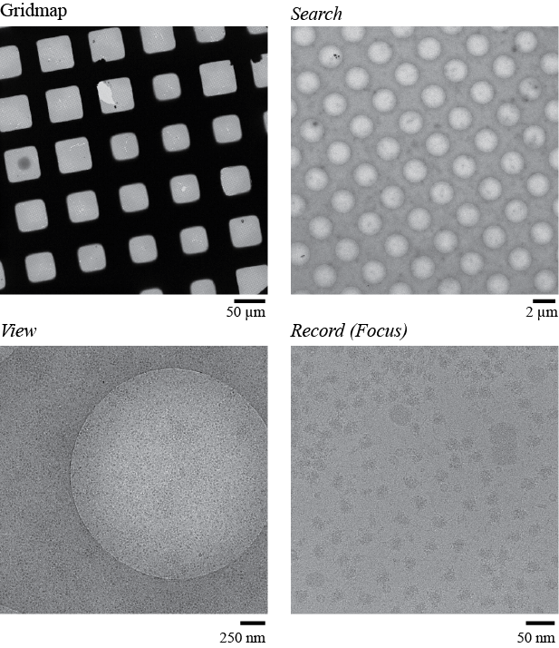
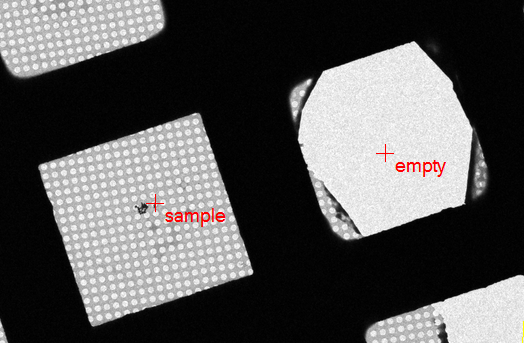
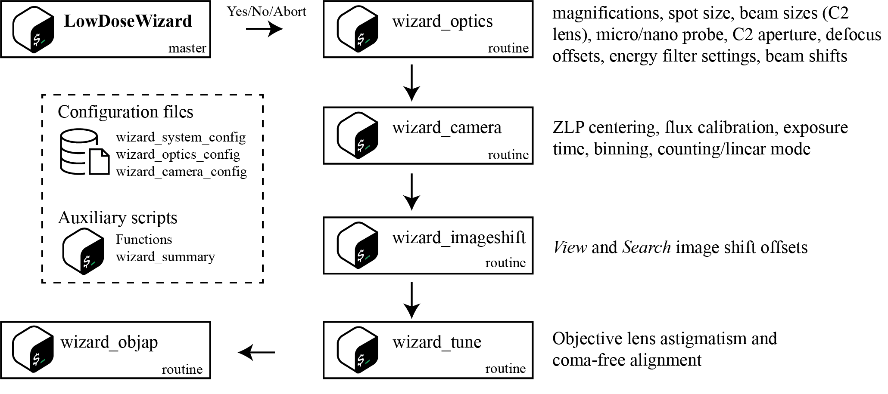
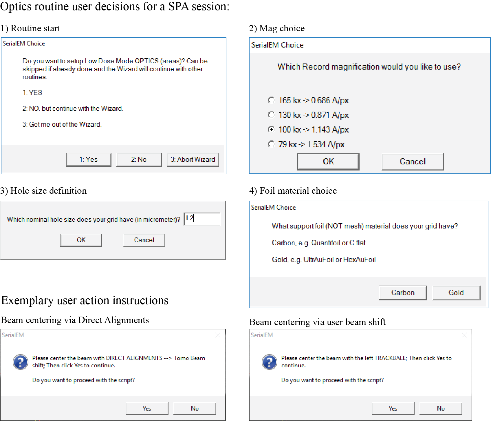

# SerialEM LowDoseWizard

## Overview
The SerialEM LowDoseWizard (LDW) is a modular set of scripts that makes setup of low dose imaging for cryo-EM/ET in SerialEM guided and user-friendly. Instead of manually configuring dozens of parameters across multiple imaging states, the wizard guides you through a step-by-step process that automatically sets up your microscope based on a few key decisions.

**Key features:**
- Automated configuration of all low dose imaging states
- Interactive guidance for beam centering, tuning, and aperture alignment
- Consistent, reproducible microscope setup across sessions
- Modular design - run complete workflow or individual routines as needed

**Preprint:**
- [bioRxiv](https://www.biorxiv.org/content/10.64898/2026.05.05.722937v1)
- Find a video of the workflow in the [supplement](https://www.biorxiv.org/content/10.64898/2026.05.05.722937v1.supplementary-material)

## Quick Start

### Requirements
- SerialEM version 4.2.X or higher (version 4.3.0beta recommended for best experience)
- [Download SerialEM](https://bio3d.colorado.edu/SerialEM/download.html)

### Installation

1. **Add the wizard scripts** to your SerialEM script collection:
   - Add all [scripts](/scripts) to SerialEM
       - 💡 If you are using SerialEM version 4.3.0beta or higher, use the [01_wizard_optics.txt](/scripts_4.3/01_wizard_optics.txt) script from the [scripts_4.3](/scripts_4.3) folder; all other scripts are version independent.
   - Script numbers and order don't matter
   - Functions from [functions.txt](/scripts/functions.txt) can be added to any existing function script (see [Functions](#functions) for further details)

2. **Configuration for your microscope**:
   - Copy configuration files from [config](/config) to your SerialEM system path (e.g., `C:\ProgramData\SerialEM\`)
   - Edit each config file with parameters specific to your microscope (see [Configuration Reference](#configuration-reference))

### Usage

1. **Acquire a grid map (atlas)**
   - Use your usual parameters to acquire a grid map

2. **Set up navigator points**:
   - Add one navigator point over vacuum and label it `empty`
   - Add one navigator point over sample and label it `sample`
   
3. **Run the wizard**:
   - Run the `LowDoseWizard` script
   - Follow the prompts to configure your microscopy session

💡**Note**: Acquiring a grid map is not strictly necessary. As long as `empty` and `sample` points are added to the Navigator, the LDW can be executed.

### File Structure
```
SerialEM/
├── scripts/
│   ├── lowdosewizard.txt           # Master script
│   ├── 01_wizard_optics.txt
│   ├── 02_wizard_camera.txt
│   ├── 03_wizard_imageshift.txt
│   ├── 04_wizard_tune.txt
│   ├── 05_wizard_objap.txt
│   ├── 06_wizard_summary.txt
│   └── functions.txt               # Required functions
└── config/
    ├── wizard_system_config.txt    # Microscope hardware info
    ├── wizard_optics_config.txt    # Magnifications, beam sizes, etc.
    └── wizard_camera_config.txt    # Fluence, exposure times, etc.
```

---

## Concepts

### Imaging States
The LDW uses five distinct imaging states, each optimized for a specific purpose.

| State      | Typical Mag | Purpose | Low Dose Mode |
|------------|-------------|---------|---------------|
| **Gridmap** | 125x | Acquire grid map/atlas | No |
| **Search** | 2,250x (SPA)<br>Variable (Tomo) | Medium mag maps of lamella/square | Yes |
| **View** | 8,700x (Tomo)<br>15,000x (SPA) | Realign to target / hole centering | Yes |
| **Record** | 42,000x (Tomo)<br>165,000x (SPA) | Acquire raw data | Yes |
| **Focus** | Same as *Record* | Focusing images | Yes |

**Field of view comparison** (typical SPA setup):



*For complete grid/square coverage, Gridmap requires ~6×6 montage; Search requires 2×2 (300 mesh) or 3×3 (200 mesh) montage.*

💡**Note**: The LDW assumes that *Focus* and *Trial* are identical and sets them up accordingly

⚠️ **Note**: The Gridmap state is not setup or managed by the LDW. You can use the usual parameters you use to acquire your grid map / atlas.

### Nomenclature
- **Low dose area** and **low dose state** are used interchangeably
- Imaging states are written in *italics* (e.g., *View*, *Record*)
- See [abbreviations](#abbreviations) for commonly used terms

---

## Prerequisites

Before running the LDW, you must set up two navigator points:

1. **Acquire a grid map**

2. **Mark an empty area**:
   - At navigator point at an area over vacuum (broken foil, etc.)
   - Change label to `empty`
   - Used for: optics setup and camera flux measurement

3. **Mark a sample area**:
   - Add navigator point at a representative area with features (foil holes, contamination, etc.)
   - Change label to `sample`
   - Used for: image shift calibration, tuning, and objective aperture alignment



⚠️ **Important**: If you don't have any empty areas, you can use the sample area for all routines, but ensure the grid map was acquired at eucentric height. It is still required to have two navigator points, one labeled `empty` and the other `sample`, but those can be at the identical position.

Once these points are defined, run the `LowDoseWizard` script to begin.

---

## Workflow Overview

The LDW follows a modular design - you can run the complete workflow or skip to specific routines as needed:



### Routine Summary

| Routine | Script | What It Does | Comment |
|---------|--------|--------------|-----------|
| **Optics** | wizard_optics | Sets magnifications and beam parameters | ✓ Required (run first) |
| **Camera** | wizard_camera | Calibrates flux and sets exposure times | ✓ Required for summary file |
| **Image Shift** | wizard_imageshift | Aligns FOV across all low dose states | Necessary after changing mags |
| **Tuning** | wizard_tune | Automated astigmatism correction and coma-free alignment | Requires Thon rings |
| **Objective Aperture** | wizard_objap | Inserts objective aperture and guides user through centering | Optional; also included in Tuning |
| **Summary** | wizard_summary | Generates summary file | Automatic |

💡 **Note**: Script file names include a number prefix (e.g. `01_wizard_optics.txt`) 

⚠️ **Important**: All wizard scripts are designed to be called via the master `LowDoseWizard` [script](/scripts/lowdosewizard.txt). They cannot be run as standalone scripts as they depend on variables and configurations loaded by the master script.

---

## Detailed Routine Guide

### 1. Optics Routine

**Purpose**: Configure magnifications and illumination settings for all low dose states.

**Location**: Empty area (prompts guide beam centering on flu screen)

**User Decisions**:

| Question | Options | Sets |
|----------|---------|------|
| Session type? | Tomo / SPA | Determines follow-up questions |
| Record magnification? | Pre-defined mags | *Record* and *Focus* mags |
| MMM detail? (Tomo) | High / Medium / Low | *Search* mag |
| Foil hole size? (SPA) | Size in µm | *View* mag (FOV ≈ 2× hole size) |
| Foil hole material? (SPA) | Carbon / Gold | Defocus offsets, *Search* imaging mode |

**What Gets Set Automatically**:
- Spot sizes (same for all states, optimized for *Record*)
- C2 aperture size(s)
- Beam sizes
- Probe mode (mP or nP)
- Energy filter settings

**Output**: Fully configured and activated low dose states

**Example workflow** (SPA session):



⚠️ **Critical**: After completion of the LDW, the *Focus* shift and rotation offset relative to *Record*, i.e. the target area for autofocus still needs to be defined.

---

### 2. Camera Routine

**Purpose**: Set fluence, exposure times, and camera parameters for all states.

**Location**: Empty area (required for ZLP centering and flux calibration)

**User Decisions**:

| Question | Options | Sets |
|----------|---------|------|
| Fluence per tilt (Tomo) or exposure (SPA)? | e⁻/Ų | *Record* exposure time |

**What Gets Set Automatically**:
- Exposure times for *Preview*, *Focus*, *View*, *Search*
- Binning for all states
- Read-out modes (counting/linear)
- Frame saving on/off, frame alignment, dose fractionation, image processing

**How It Works**:
1. Calibrates flux on camera over empty area
2. Calculates exposure times based on desired fluence and measured flux
3. Applies pre-defined camera settings from config file

**Output**: Configured camera parameters for all low dose states plus *Preview* (same optics as *Record* but different camera parameters).

💡 **Note**: *Preview* is used for quick checks during the Image Shift and Tuning routines.

⚠️ **Critical**: Frame saving parameters like folder and file name are not part of the LDW and need to be manually set before starting data acquisition.

⚠️ **Important**: Always review camera settings after LDW completion, especially before starting data collection.

---

### 3. Image Shift Routine

**Purpose**: Calibrate image shift offsets so the same feature is centered in all low dose states.

**Location**: Sample area (requires visible features)

**User Decisions**:

| Question | Options | Sets |
|----------|---------|------|
| Refine position? | Interactive adjustment | Stage X,Y |

**How It Works**:
1. Sets eucentric height
2. Prompts you to confirm/refine position to ensure suitable features in FOV
3. Runs automated SerialEM `FindLowDoseShiftOffset` for *View* and *Search*

💡 **Tip**: Choose an area with distinct features like foil hole edges or contamination spots for best results.

**Output**: Calibrated image shift offsets for *View* and *Search* relative to *Record*

⚠️ **Critical**: After completion of the LDW, the shift offset between the low dose states and the grid map still needs to be fixed using the `Shift To Marker` functionality. 

---

### 4. Tuning Routine

**Purpose**: Automated astigmatism correction and coma-free alignment using CTF fitting.

**Location**: Sample area (needs visible Thon rings)

**User Decisions**:

| Question | Options | Sets |
|----------|---------|------|
| Refine position? | Interactive adjustment | Stage X,Y |
| Target defocus? | Defocus in µm | Stage Z (at eucentric focus) |
| Objective aperture? | Size or None | Which aperture to insert |

**How It Works**:
1. Refine position to ensure sufficient Thon rings in power spectrum
2. Retract objective aperture (if inserted)
3. Set target defocus via stage Z
4. Run automated `FixAstigmatismByCTF`
5. Run automated `FixComaByCTF`
6. Insert selected objective aperture (if chosen)
7. Prompt for manual centering of aperture
8. Re-run astigmatism correction

⚠️ **Note**: Make sure the autoloader turbo is not running during the routine. The routine automatically pauses if dewars are refilling.

**Output**: Corrected objective lens astigmatism and coma-free alignment, centered objective aperture (if selected)

⚠️ **Note**: Before starting data acquisition, energy filter tuning needs to be performed in Digital Micrograph or Sherpa. `Calibrate Coma vs Image Shift` is not part of the LDW and should be performed, especially if TFS AFIS is not 'always on'. It is also recommended to redo astigmatism correction and coma-free alignment, ideally after ~30 minutes of ongoing data collection.

---

### 5. Objective Aperture Routine

**Purpose**: Insert and center objective aperture (only if tuning routine was skipped).

**Location**: Sample area

**User Decisions**:

| Question | Options |
|----------|---------|
| Which aperture? | Size or None |

**Output**: Inserted and manually centered objective aperture

⚠️ **Note**: Suitable camera length (diffraction mode) for objective aperture centering needs to be defined in the `wizard_optics_config` file (`Cam_length`). The defined value is used with the SerialEM `SetCamLenIndex` command. 

---

### 6. Summary Generation

**Automatic**: Runs after completing optics and camera routines.

**Creates human-readable session summary** (in SerialEM working directory):

**`LowDoseWizard_summary.txt`**:
   ```
   EMBL ImagingCentre, 20251029
   Glacios FFI (aka 'Glacios1')
   SelectrisX Falcon4i
   Operating voltage = 200 kV
   Cs = 2.7 mm
   C2 aperture = 20 microns
   No objective aperture inserted.

   Record: 130 kx (0.8711 A/px), 50 e-/A^2 fluence, 4.63 s exposure,
   8.2 e/px/s flux over empty area, Counting mode, spot 3 nanoProbe,
   EFTEM 10 eV slit width
   ```

💡 **Reusing Settings**: A machine-readable **`ldw_parameters.txt`** file is written out (and appended to) by the optics and camera routines. When you re-run the LDW, it's detected and the user can choose to utilize those parameters skipping the respective prompts in the LDW routines or to specify new parameters. If the LDW has been executed multiple times with varying parameters, the most recent ones are selected in case the `ldw_parameters.txt` file is utilized in a subsequent LDW run.

---

## Configuration Reference

The LDW's automation relies on three configuration files that must be customized for each microscope. These files define the "intelligence" behind the wizard's automatic parameter selection.

In the [config](/config/) folder you will find four sets of exemplary configuration files. One we use with the EMBL Imaging Centre Glacios (FFI, SelectrisX and Falcon 4i), one we use with our EMBL Imaging Centre Krios G4 (SelectrisX and Falcon 4i), one we use with our EMBL MSB Krios G3i (BioQuantum K3) and one we use with our EMBL MSB Talos Arctica (Falcon 3, only for screening purposes). Those files should serve as a good starting reference to create your own configuration files.

⚠️ **Critical**: The configuration files need to be adjusted for each system by facility staff most familiar with the respecitve system. Please note that the config file for the Talos Arctica as provided here, is only intended to be used for screening and not data collection.

### System Configuration (`wizard_system_config.txt`)

**Defines hardware characteristics:**
- Condenser lens system (2 or 3 lens)
- Enable or disable Tomo workflow
- Camera type and detector
- Energy filter presence and type
- SerialEM `RefineZLP` usage (can be disabled if it's known to often fail on a certain microscope)

### Optics Configuration (`wizard_optics_config.txt`)

**Defines optical parameters for each magnification and low dose state:**

**Per-Magnification Settings:**
- Pixel sizes
- Optimal spot sizes
- Optimal beam sizes
- Probe mode (mP/nP)
- C2 aperture sizes (can be mag-dependent for Glacios FFI)

**Global Settings:**
- Available objective aperture sizes
- Camera length to be used for objective aperture centering
- Defocus offsets for *View* and *Search*
- Energy filter slit widths and offsets

💡 **Tip**: Set energy filter slit width and offset for *Search* to enable plasmon imaging when using gold foil grids (15 eV width, 20 eV offset)

**Special Considerations:**

| Microscope Type | Beam Size Definition |
|----------------|---------------------|
| **Calibrated beam size** (e.g., Krios) | Direct beam size values |
| **Uncalibrated beam size** (e.g., Glacios) | C2 lens strengths per spot size and C2 aperture |

⚠️ **Note**: C2 lens strenghts refer to the ones displayed in SerialEM and NOT those displayed in the TEM UI.

⚠️ **Critical**: Finding optimal spot size and beam size combinations for each *Record* mag requires balancing:
- Optimal flux on camera
- Beam size covering (but not exceeding) camera chip

### Camera Configuration (`wizard_camera_config.txt`)

**Defines camera parameters for each low dose state:**

**Exposure/Fluence Defaults:**

| State | Tomo | SPA |
|-------|------|-----|
| *Record* | User choice | User choice |
| *Preview* | 0.5 e⁻/Ų | 0.5 sec |
| *Focus* | 3 e⁻/Ų | 0.2 sec |
| *View* | 0.05 e⁻/Ų | 0.1 e⁻/Ų |
| *Search* | 0.25 e⁻/Ų | 1 sec (ZLP), 2 sec (plasmon) |

💡 **Tip**: Set global minimal exposure time and maximal exposure time for *Search* to avoid impractical results from the flux-to-fluence calculations

**Other Parameters:**
- Binning (typically: bin 1 for *Record* and *Search*, bin 4 for *Preview*/*Focus*/*View*)
- Read-out mode (counting vs linear)
- Dose fractionation settings
- Frame saving options

---
## Functions

The LDW makes use of eight SerialEM scripting functions which are combined into the [functions.txt](/scripts/functions.txt) file. Those functions need to be included in your SerialEM script collection for the LDW to work.

**Descreption**

| Name | Purpose | Used at routine|
|-------|------| - |
| AutoFill | Checks if dewars are refilling | Tuning |
| ZwithV | Set eucentric focus with *View*  | Image Shift, Tuning |
| ZwithG | Set eucentric focus with *Focus*  | Image Shift, Tuning |
| drag_S | Interactively refine stage position with *Search* | Image Shift |
| drag_V | Interactively refine stage position with *View* | Image Shift |
| drag_P | Interactively refine stage position with *Preview* | Image Shift |
| set_ld-area | Defines a low dose state | Optics |
| set_camera | Defines camera parameters for a low dose state | Camera |

## Parameter Decision Logic

Understanding how the LDW determines parameters helps with troubleshooting and customization:

### Exemplary Decision Flow for Key Parameters (SPA)

```
User chooses Record mag
    ↓
Config defines spot size and C2 aperture size for this mag 
    ↓
Same spot size applied to ALL states (minimize hysteresis)
    ↓
Config defines beam size for Record mag
    ↓
User chooses foil hole size
    ↓
Optimal view mag is calculated
    ↓
Beam sizes for View and Search from config lookup
    ↓
User chooses foil material
    ↓
Defocus offsets and energy filter settings from config lookup
    ↓
User chooses fluence
    ↓
Flux calibration calculates Record exposure time
    ↓
Config defines fluences/exposure times for other states
    ↓
Calculate remaining exposure times
```

### Magnification Selection Logic

| State | Tomo | SPA |
|-------|------|-----|
| *Record* | User choice | User choice |
| *Focus* | Same as *Record* | Same as *Record* |
| *View* | Lowest nP with parallel beam | Calculated: FOV ≈ 2× hole size |
| *Search* | User choice (via MMM detail) | Lowest SA mag |

### Probe Mode Logic

- nP preferred whenever possible
- *Search* almost always mP (large beam size required)
- Glacios FFI: only *Record* and *Focus* in nP

### Energy Filter Logic

**Slit Widths** (defined in config):
- *Record*: Typically 10-20 eV
- *Search* (carbon foils): ZLP imaging
- *Search* (gold foils): Plasmon imaging; 15 eV width, 20 eV offset

**RefineZLP**:
- Can be enabled/disabled in system config
- Disable if experiencing errors

💡 **Tip**: Don't go below 15 eV slit width for `RefineZLP`. Can be set with `RefineZLPSlitWidth` in SerialEM properties.

---

## Troubleshooting

### Common Issues

**"Empty" or "sample" points not found**
- Ensure navigator points are labeled exactly as `empty` and `sample`

**Image shift offset calibration fails**
- Ensure clear features visible in FOV at all magnifications
- Manually refine position before calibration
- Confirm that the sample area is at eucentric height, e.g. by measuring defocus. It should be close to 0.
- Carefully observe the image alignments during the routine to spot any improbable results

⚠️ **Note**: If shifts bigger than a preset threshold ([wizard_optics_config](/config)) are detected, the routine can be repeated at a different area.

**Insufficient Thon rings for tuning**
- Choose a different sample area with more amorphous carbon or thinner ice/dry square.
- Try increasing defocus

### Getting Help

If you encounter issues not covered here, contact Simon Fromm (simon.fromm@embl.de)

---

## Contributing

Contributions, bug reports, and feature requests are welcome. Please contact Simon Fromm (simon.fromm@embl.de).

---

## Authors and Acknowledgments

**Created by**: Simon Fromm (EMBL Imaging Centre)

**Contributors**: Sebastian Unger (EMBL MSB Unit), Zhengyi Yang (EMBL Imaging Centre)

**Special thanks**: EMBL TEM user community for testing, bug reports, and feature requests

---

## Abbreviations

| Term | Definition |
|------|------------|
| AFIS | Aberration-free image shift |
| FFI | Fringe-free Illumination |
| FOV | Field Of View |
| LDW | LowDoseWizard |
| mag | Magnification |
| MMM | Medium Magnification Map |
| mP | MicroProbe (TFS TEM) |
| nP | NanoProbe (TFS TEM) |
| PS | Power Spectrum |
| px | Pixel |
| SA | Selected Area aperture magnification range (TFS microscopes) |
| SPA | Single Particle Analysis |
| TEM | Transmission Electron Microscope |
| TFS | Thermo Fisher Scientific |
| Tomo | Tomography |
| ZLP | Zero Loss Peak |
